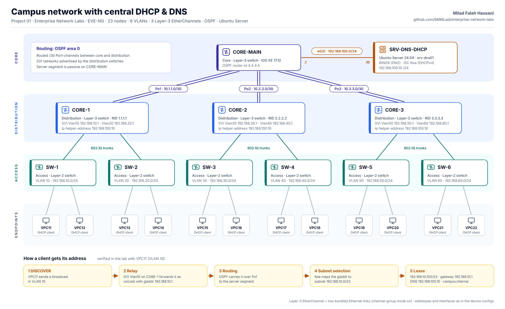
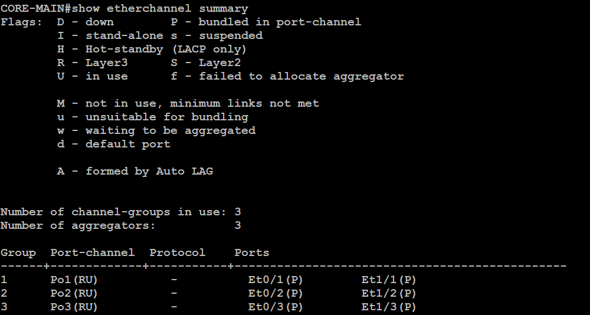
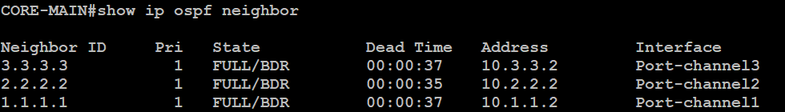
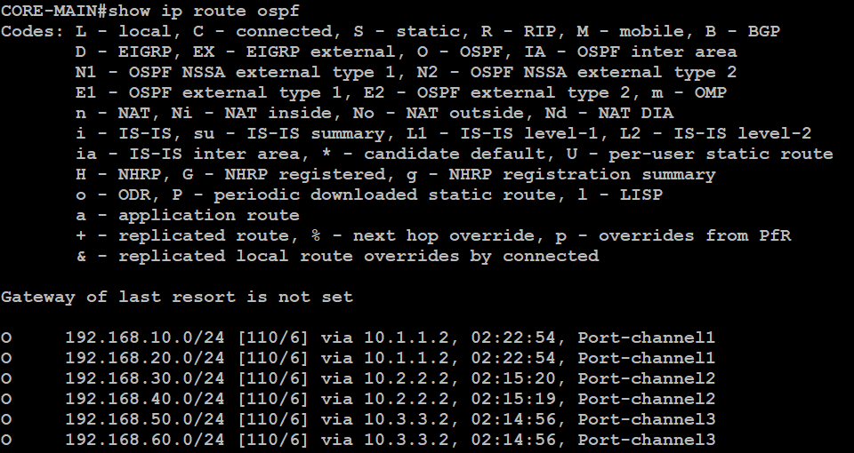
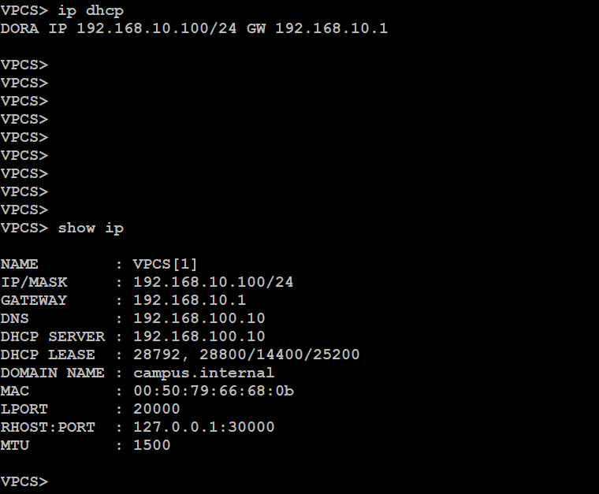
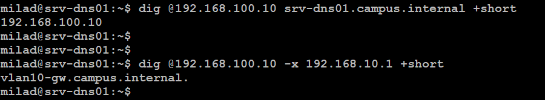

# Project 01: Campus network with central DHCP and DNS


A three-tier campus network (core, distribution, access) with six VLANs. Core and distribution are connected by routed Layer-3 EtherChannels running OSPF. One Ubuntu server hands out addresses to every VLAN through DHCP relay (ISC Kea) and resolves names forward and reverse (BIND9).

> 🇩🇪 **Kurzfassung:** Dreistufiges Campus-Netz (Core, Distribution, Access) mit sechs VLANs. Core und Distribution sind über geroutete Layer-3-EtherChannels und OSPF verbunden. Ein zentraler Ubuntu-Server vergibt per DHCP-Relay die Adressen für alle VLANs (ISC Kea) und löst Namen vorwärts und rückwärts auf (BIND9).



## At a glance

| | |
|---|---|
| **Platform** | EVE-NG Community Edition on VMware Workstation |
| **Nodes** | 23: four multilayer switches, six access switches, one Linux server, twelve clients |
| **Switching** | 6 VLANs, 802.1Q trunks between distribution and access, PortFast on client ports |
| **Core links** | 3 routed Layer-3 EtherChannels, two Ethernet links each |
| **Routing** | OSPF, single area 0 |
| **DHCP** | ISC Kea DHCPv4 on Ubuntu, reached through `ip helper-address` on every SVI |
| **DNS** | BIND9, forward zone `campus.internal` and reverse zone `168.192.in-addr.arpa` |

## Design

### Devices

| Device | Layer | Platform | Role |
|---|---|---|---|
| CORE-MAIN | Core | Cisco IOS XE 17.12 (IOL) | Routed core, three Layer-3 EtherChannels, gateway of the server segment, OSPF router-id 4.4.4.4 |
| CORE-1 | Distribution | Cisco IOS XE 17.12 (IOL) | SVIs for VLAN 10 and 20, DHCP relay, OSPF router-id 1.1.1.1 |
| CORE-2 | Distribution | Cisco IOS XE 17.12 (IOL) | SVIs for VLAN 30 and 40, DHCP relay, OSPF router-id 2.2.2.2 |
| CORE-3 | Distribution | Cisco IOS XE 17.12 (IOL) | SVIs for VLAN 50 and 60, DHCP relay, OSPF router-id 3.3.3.3 |
| SW-1 to SW-6 | Access | Cisco IOS 15.2 (IOL) | One VLAN per switch, two client ports with PortFast |
| SRV-DNS-DHCP | Server | Ubuntu Server 24.04 | Hostname `srv-dns01`, BIND9 and ISC Kea DHCPv4 |
| VPC11 to VPC22 | Clients | VPCS | DHCP clients, two per access switch |

### Addressing

| Segment | Subnet | Gateway | Members |
|---|---|---|---|
| VLAN 10 | 192.168.10.0/24 | 192.168.10.1, SVI on CORE-1 | SW-1, VPC11, VPC12 |
| VLAN 20 | 192.168.20.0/24 | 192.168.20.1, SVI on CORE-1 | SW-2, VPC13, VPC14 |
| VLAN 30 | 192.168.30.0/24 | 192.168.30.1, SVI on CORE-2 | SW-3, VPC15, VPC16 |
| VLAN 40 | 192.168.40.0/24 | 192.168.40.1, SVI on CORE-2 | SW-4, VPC17, VPC18 |
| VLAN 50 | 192.168.50.0/24 | 192.168.50.1, SVI on CORE-3 | SW-5, VPC19, VPC20 |
| VLAN 60 | 192.168.60.0/24 | 192.168.60.1, SVI on CORE-3 | SW-6, VPC21, VPC22 |
| Server segment | 192.168.100.0/24 | 192.168.100.1, CORE-MAIN Et0/0 | SRV-DNS-DHCP at 192.168.100.10 |

Every VLAN uses the DHCP pool `.100` to `.200`. Addresses outside the pool stay free for static assignments.

### Layer-3 EtherChannels

| Port-channel | Subnet | CORE-MAIN (.1) | Peer (.2) |
|---|---|---|---|
| Po1 | 10.1.1.0/30 | Et0/1, Et1/1 | CORE-1: Et0/0, Et0/1 |
| Po2 | 10.2.2.0/30 | Et0/2, Et1/2 | CORE-2: Et0/0, Et0/2 |
| Po3 | 10.3.3.0/30 | Et0/3, Et1/3 | CORE-3: Et0/0, Et0/3 |

## Implementation highlights

All snippets are taken from the files in [`configs/`](configs).

### 1. Routed Port-channels between core and distribution

The member ports are taken out of Layer 2 first, then bundled. The IP address lives on the Port-channel interface.

```
interface Port-channel1
 no switchport
 ip address 10.1.1.1 255.255.255.252
!
interface Ethernet0/1
 no switchport
 no ip address
 channel-group 1 mode on
!
interface Ethernet1/1
 no switchport
 no ip address
 channel-group 1 mode on
```

### 2. OSPF

CORE-MAIN advertises the three transit networks and the server segment. The server port is passive, so no OSPF hellos are sent towards the host.

```
router ospf 1
 router-id 4.4.4.4
 passive-interface Ethernet0/0
 network 10.1.1.0 0.0.0.3 area 0
 network 10.2.2.0 0.0.0.3 area 0
 network 10.3.3.0 0.0.0.3 area 0
 network 192.168.100.0 0.0.0.255 area 0
```

Each distribution switch advertises its transit network and its two VLAN subnets (CORE-1 shown):

```
router ospf 1
 router-id 1.1.1.1
 network 10.1.1.0 0.0.0.3 area 0
 network 192.168.10.0 0.0.0.255 area 0
 network 192.168.20.0 0.0.0.255 area 0
```

### 3. Inter-VLAN routing and DHCP relay

The SVIs on the distribution switches are the default gateways. The same interfaces forward DHCP broadcasts to the central server.

```
interface Vlan10
 ip address 192.168.10.1 255.255.255.0
 ip helper-address 192.168.100.10
!
interface Vlan20
 ip address 192.168.20.1 255.255.255.0
 ip helper-address 192.168.100.10
```

### 4. Central DHCP with ISC Kea

Global options apply to every subnet. Each subnet only adds its own gateway. Full file: [`kea-dhcp4.conf`](configs/ubuntu/etc/kea/kea-dhcp4.conf).

```json
"option-data": [
  { "name": "domain-name-servers", "data": "192.168.100.10" },
  { "name": "domain-name",         "data": "campus.internal" },
  { "name": "domain-search",       "data": "campus.internal" }
],
"subnet4": [
  {
    "id": 10,
    "subnet": "192.168.10.0/24",
    "user-context": { "vlan": 10, "gateway-switch": "CORE-1" },
    "pools": [ { "pool": "192.168.10.100 - 192.168.10.200" } ],
    "option-data": [ { "name": "routers", "data": "192.168.10.1" } ]
  },
```

The server is not connected to any client VLAN. It picks the right subnet from the relay address (`giaddr`) that the SVI writes into the forwarded request.

The path of a request from VLAN 10:

| Step | Device | What happens |
|---|---|---|
| 1 | VPC11 | Sends its DHCP discover as a broadcast. A broadcast does not leave VLAN 10. |
| 2 | CORE-1, Vlan10 | Writes its own address 192.168.10.1 into `giaddr` and forwards the request as a unicast to 192.168.100.10. |
| 3 | srv-dns01, Kea | Finds the subnet that contains `giaddr`, 192.168.10.0/24, and offers 192.168.10.100 from its pool. |
| 4 | CORE-1, Vlan10 | Receives the reply, which the server sends to 192.168.10.1, and delivers it to the client. |

So `giaddr` does two jobs: it tells the server which VLAN the request came from, and it is the address the reply goes back to. Two things follow from that. The server needs a route back to every VLAN subnet, here the default route to CORE-MAIN, which learns the subnets through OSPF. And a request from a VLAN without a matching `subnet4` entry gets no answer.

### 5. DNS with BIND9

BIND9 is authoritative for the lab domain and for one reverse zone that covers all `192.168.x.x` subnets. It also answers recursive queries, but only for the lab networks. Files: [`named.conf.options`](configs/ubuntu/etc/bind/named.conf.options), [`named.conf.local`](configs/ubuntu/etc/bind/named.conf.local), [`zones/`](configs/ubuntu/etc/bind/zones).

```
zone "campus.internal" {
    type primary;
    file "/etc/bind/zones/db.campus.internal";
    allow-update { none; };
};

zone "168.192.in-addr.arpa" {
    type primary;
    file "/etc/bind/zones/db.192.168";
    allow-update { none; };
};
```

```
srv-dns01       IN  A     192.168.100.10
dns             IN  CNAME srv-dns01
core-main       IN  A     192.168.100.1
vlan10-gw       IN  A     192.168.10.1
core-1          IN  CNAME vlan10-gw
```

The Cisco switches use the server as their resolver:

```
ip name-server 192.168.100.10
ip domain name campus.internal
```

## From local pools to one central server

The first version of this lab served every VLAN from an IOS DHCP pool on its own distribution switch. That works, but the address plan is then spread over three devices and every change has to be made in several places.

I moved the service to one server instead. The pools were removed from the switches, the SVIs received `ip helper-address`, and the Ubuntu server took over all six subnets. The repository shows this final state.

## Verification

### EtherChannel

All three bundles are Layer 3 (`R`), in use (`U`), and both member ports are bundled (`P`). The protocol column shows `-` because the channels are static.

```
CORE-MAIN#show etherchannel summary
Group  Port-channel  Protocol    Ports
------+-------------+-----------+-----------------------------------------------
1      Po1(RU)          -        Et0/1(P)        Et1/1(P)
2      Po2(RU)          -        Et0/2(P)        Et1/2(P)
3      Po3(RU)          -        Et0/3(P)        Et1/3(P)
```

<details><summary>Screenshot</summary>


</details>

### OSPF

CORE-MAIN is fully adjacent with all three distribution switches and learns the six VLAN subnets over the Port-channels.

```
CORE-MAIN#show ip ospf neighbor

Neighbor ID     Pri   State           Dead Time   Address         Interface
3.3.3.3           1   FULL/BDR        00:00:37    10.3.3.2        Port-channel3
2.2.2.2           1   FULL/BDR        00:00:35    10.2.2.2        Port-channel2
1.1.1.1           1   FULL/BDR        00:00:37    10.1.1.2        Port-channel1
```

```
CORE-MAIN#show ip route ospf
O     192.168.10.0/24 [110/6] via 10.1.1.2, 02:22:54, Port-channel1
O     192.168.20.0/24 [110/6] via 10.1.1.2, 02:22:54, Port-channel1
O     192.168.30.0/24 [110/6] via 10.2.2.2, 02:15:20, Port-channel2
O     192.168.40.0/24 [110/6] via 10.2.2.2, 02:15:19, Port-channel2
O     192.168.50.0/24 [110/6] via 10.3.3.2, 02:14:56, Port-channel3
O     192.168.60.0/24 [110/6] via 10.3.3.2, 02:14:56, Port-channel3
```

<details><summary>Screenshots</summary>




</details>

### DHCP end to end

VPC11 sits in VLAN 10 behind SW-1 and CORE-1. Its lease proves the whole chain: relay on the SVI, OSPF to the server segment, subnet selection in Kea and the options from the central configuration.

```
VPCS> ip dhcp
DORA IP 192.168.10.100/24 GW 192.168.10.1

VPCS> show ip

NAME        : VPCS[1]
IP/MASK     : 192.168.10.100/24
GATEWAY     : 192.168.10.1
DNS         : 192.168.100.10
DHCP SERVER : 192.168.100.10
DHCP LEASE  : 28792, 28800/14400/25200
DOMAIN NAME : campus.internal
```

| Field | Value | Comes from |
|---|---|---|
| Address | 192.168.10.100 | First address of the VLAN 10 pool |
| Gateway | 192.168.10.1 | `routers` option of subnet 10 |
| DNS, domain | 192.168.100.10, `campus.internal` | Global options |
| DHCP server | 192.168.100.10 | The central server, not the local switch |
| Lease, T1, T2 | 28800 s, 14400 s, 25200 s | `valid-lifetime`, `renew-timer`, `rebind-timer` |

<details><summary>Screenshot</summary>


</details>

### DNS

A forward lookup returns the address of the server. A reverse lookup of the VLAN 10 gateway returns its name from the reverse zone.

```
$ dig @192.168.100.10 srv-dns01.campus.internal +short
192.168.100.10
$ dig @192.168.100.10 -x 192.168.10.1 +short
vlan10-gw.campus.internal.
```

<details><summary>Screenshot</summary>


</details>

## What I learned

- **How the server finds the right subnet.** The relaying SVI writes its own address into the `giaddr` field. Kea compares it with the configured subnets, so each VLAN needs its own `subnet4` entry even though the server has only one interface.
- **The trailing dot in zone files.** A name without a final dot is relative to the zone. `srv-dns01.campus.internal` without the dot becomes `srv-dns01.campus.internal.campus.internal`.
- **Troubleshooting the lab itself.** The EVE-NG VM had no Internet access and could not resolve names. The cause was a duplicate IP address: the Windows host adapter (VMnet8) used the same address as the VMware NAT gateway. After changing the adapter address, restarting the NAT service and flushing the neighbour cache, the VM was online.

## Limits and next steps

This lab focuses on services and routed links. It is not yet highly available:

- One core switch and single uplinks to the access layer are single points of failure.
- The EtherChannels are static (`mode on`). LACP would detect a miscabled or failed member link.
- The trunks are negotiated with DTP. In production I would configure static trunks and restrict the allowed VLANs.
- The SVIs take part in OSPF without `passive-interface`. Client VLANs should be passive.
- DHCP and DNS run on one server. Kea high availability and a secondary DNS server would remove this dependency.

## Repository layout

```
01-campus-dhcp-dns/
├── README.md
├── configs/
│   ├── cisco/        startup-configs of the ten switches
│   ├── ubuntu/etc/   BIND9 and Kea files with their original paths
│   └── vpcs/         startup script of the twelve clients
├── docs/
│   ├── topology.png
│   └── evidence/     screenshots of the verification commands
└── eve-ng/
    └── campus-dhcp-dns.unl   lab file with all startup-configs embedded
```

The Cisco files are the saved startup-configs, exported with EVE-NG. EVE-NG adds `no shutdown` under every interface so that the configs can be loaded on fresh nodes.

## Rebuild the lab

1. EVE-NG with these IOL images: `L2-ADVENTERPRISEK9-XE-17.12.1.bin` for the multilayer switches and `L2-ADVIPSERVICESK9-M-15.2-IRON-20170202.bin` for the access switches. Cisco images are licensed and not part of this repository.
2. Import [`eve-ng/campus-dhcp-dns.unl`](eve-ng/campus-dhcp-dns.unl). The switch configurations, including the VLANs, are embedded as startup-configs.
3. Replace the server node with your own Ubuntu Server 24.04 image. Give it the address 192.168.100.10/24 with gateway 192.168.100.1 and install the services: `sudo apt install bind9 kea-dhcp4-server`.
4. Copy the files from [`configs/ubuntu/etc/`](configs/ubuntu/etc) to `/etc/`, check them and restart the services:

   ```
   sudo named-checkconf
   sudo named-checkzone campus.internal /etc/bind/zones/db.campus.internal
   sudo kea-dhcp4 -t /etc/kea/kea-dhcp4.conf
   sudo systemctl restart named kea-dhcp4-server
   ```
5. Start all nodes and run `ip dhcp` on a client.

The switches run in VTP transparent mode on purpose. In the default server mode a switch keeps its VLANs only in `vlan.dat`, and that file is not part of an EVE-NG export: a lab rebuilt from the exported configurations then starts with all SVIs down. In transparent mode the VLANs are written into the configuration.

---

Part of the [Enterprise Network Labs](../README.md) series by [Milad Falah Hassani](https://www.linkedin.com/in/milad-falah-hassani-4105b0416).
