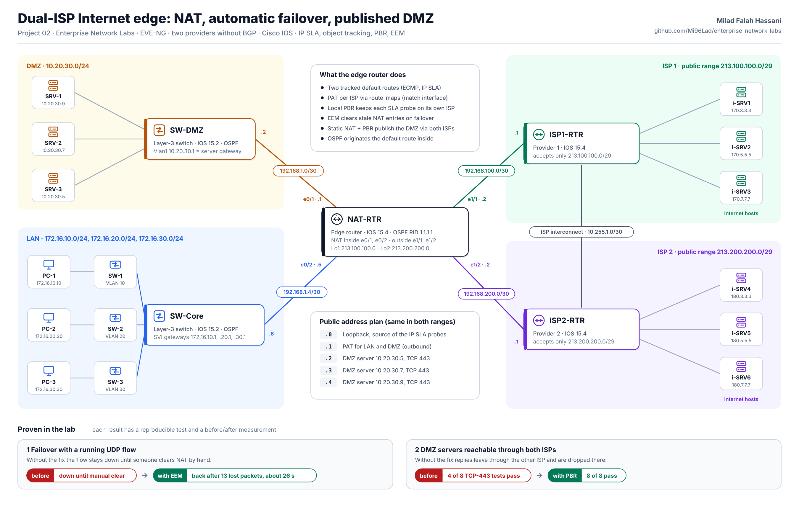
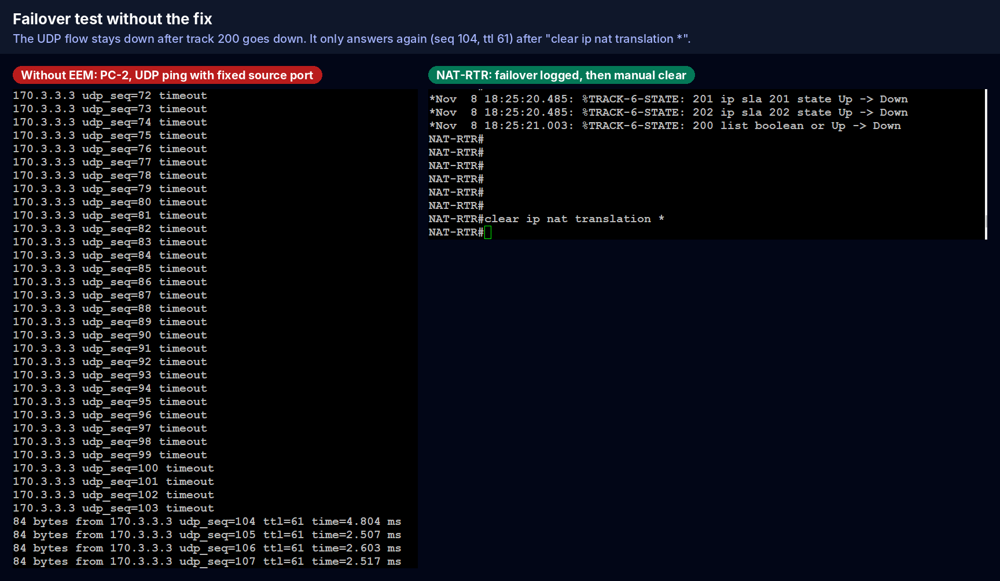
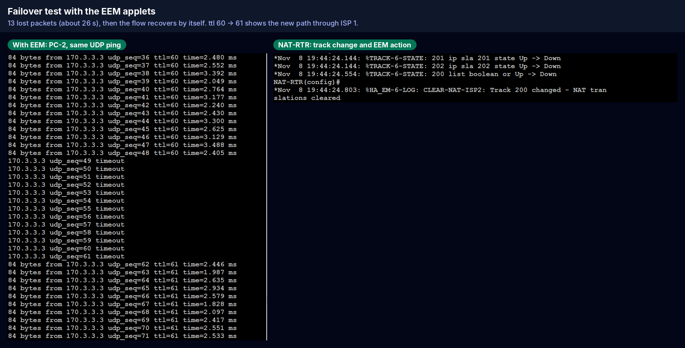
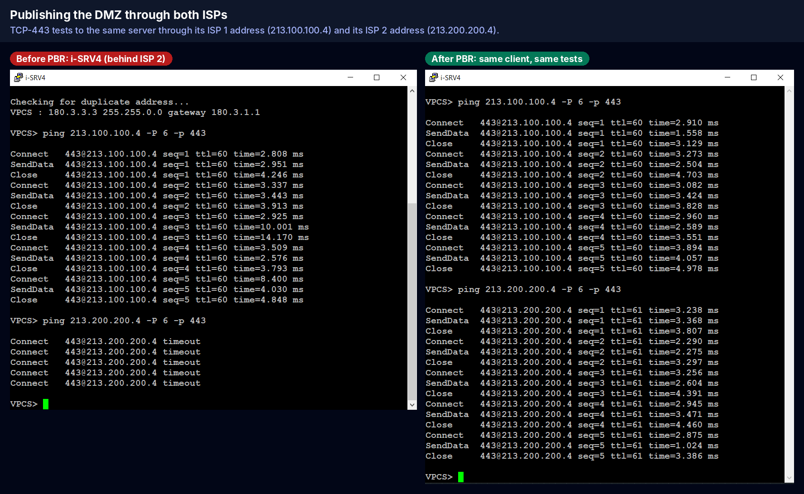

# Project 02: Dual-ISP Internet edge without BGP


An enterprise network with a LAN and a DMZ is connected to two Internet providers. There is no BGP and no provider-independent address space: each ISP routes its own /29 to the site and drops every packet with a different source address.

The edge router uses both links at the same time, fails over and back automatically, and publishes the DMZ servers through both providers.

This is a common way to connect a smaller site to two providers, and I know the design from project work. It has two problems that are easy to miss. This lab reproduces both with a test that can be repeated, explains the cause and fixes them.

> 🇩🇪 **Kurzfassung:** LAN und DMZ sind ohne BGP an zwei Provider angebunden. Beide Leitungen sind gleichzeitig aktiv, NAT übersetzt pro ISP in dessen Adressbereich, und IP SLA mit Object Tracking schaltet bei einem Ausfall automatisch um und zurück. Zwei Probleme dieses Designs habe ich im Lab nachgewiesen, erklärt und gelöst: hängende UDP-Flows nach dem Failover (EEM) und die Veröffentlichung der DMZ-Server über beide ISPs (Static NAT plus PBR).



## Results

| Test | Before | After |
|---|---|---|
| Running UDP flow during an ISP failure | Down until NAT was cleared by hand (83 lost packets in the test) | Recovers by itself after 13 lost packets, about 26 s |
| TCP 443 to the DMZ servers through both ISPs | 4 of 8 tests pass | 8 of 8 pass |

## Requirements

1. Both ISP links carry traffic at the same time.
2. Traffic that leaves through an ISP uses a source address from that ISP's range.
3. If one ISP fails, all traffic moves to the other one. When it returns, the link is used again. Both without manual work.
4. The inside network only receives a default route while at least one ISP works.
5. The DMZ servers are reachable on TCP 443 through both ISPs.

## Addressing

### Links

| Device | Interface | Address | Connected to | Role |
|---|---|---|---|---|
| NAT-RTR | Et0/1 | 192.168.1.1/30 | SW-DMZ Et0/1 (.2) | NAT inside, policy routing for server replies |
| NAT-RTR | Et0/2 | 192.168.1.5/30 | SW-Core Et0/2 (.6) | NAT inside |
| NAT-RTR | Et1/1 | 192.168.100.2/30 | ISP1-RTR Et1/1 (.1) | NAT outside |
| NAT-RTR | Et1/2 | 192.168.200.2/30 | ISP2-RTR Et1/2 (.1) | NAT outside |
| NAT-RTR | Loopback1, Loopback2 | 213.100.100.0/32, 213.200.200.0/32 | | Sources of the IP SLA probes |
| ISP1-RTR | Et1/0 | 10.255.1.1/30 | ISP2-RTR Et1/0 (.2) | Link between the providers |
| SW-DMZ | Vlan1 | 10.20.30.1/24 | SRV-1, SRV-2, SRV-3 | Gateway of the DMZ |
| SW-Core | Vlan10, Vlan20, Vlan30 | 172.16.10.1/24, 172.16.20.1/24, 172.16.30.1/24 | SW-1, SW-2, SW-3 | Gateways of the LAN |

Internet hosts for testing: 170.3.3.3, 170.5.5.5 and 170.7.7.7 behind ISP 1, and 180.3.3.3, 180.5.5.5 and 180.7.7.7 behind ISP 2.

### Public address plan

The same layout is used in both ranges, 213.100.100.0/29 from ISP 1 and 213.200.200.0/29 from ISP 2.

| Host part | Use |
|---|---|
| .0 | Loopback on NAT-RTR, source of the IP SLA probes |
| .1 | PAT for all outbound traffic from LAN and DMZ |
| .2 | DMZ server 10.20.30.5 (SRV-3), TCP 443 |
| .3 | DMZ server 10.20.30.7 (SRV-2), TCP 443 |
| .4 | DMZ server 10.20.30.9 (SRV-1), TCP 443 |

## How the edge router works

All snippets are taken from [`configs/NAT-RTR.cfg`](configs/NAT-RTR.cfg).

### 1. Two default routes, each tied to a health check

Both routes have the same administrative distance, so the router uses both and shares the load per pair of source and destination address (ECMP). A route disappears when its track object goes down.

```
ip route 0.0.0.0 0.0.0.0 192.168.100.1 track 100
ip route 0.0.0.0 0.0.0.0 192.168.200.1 track 200
```

### 2. Health checks with two targets per ISP

Each ISP is checked with two ICMP probes. The track list uses a logical OR, so a single dead target on the Internet does not trigger a failover. The delay of 15 seconds prevents flapping.

```
track 100 list boolean or
 object 101
 object 102
!
track 101 ip sla 101
 delay down 15 up 15
!
ip sla 101
 icmp-echo 170.7.7.7 source-interface Loopback1
 frequency 5
ip sla schedule 101 life forever start-time now
```

| Track | Checks | Probe source | Targets |
|---|---|---|---|
| 100 | ISP 1 | Loopback1, 213.100.100.0 | 170.7.7.7 behind ISP 1, 180.5.5.5 behind ISP 2 |
| 200 | ISP 2 | Loopback2, 213.200.200.0 | 170.3.3.3 behind ISP 1, 180.7.7.7 behind ISP 2 |

### 3. Every probe stays on its own ISP

This is the part that makes failback work. Three details belong together:

- **Public source address.** The probes use a loopback address from the ISP's own range. Any other source would be dropped by the provider's ingress filter, and the reply can only come back through the same ISP.
- **Local policy routing.** Without it, a probe follows the routing table. After a failover the only default route points to the other ISP, the probe for the failed ISP would leave there, be dropped, and the track would never come up again. The route-map sends each probe to its own next hop, whatever the routing table says.
- **No NAT for probes.** The probes are generated by the router and already carry a public address, so the health check never depends on the NAT table.

```
interface Loopback1
 description SLA-SOURCE-ISP1
 ip address 213.100.100.0 255.255.255.255
!
ip access-list standard SLA-SRC-ISP1
 permit 213.100.100.0
!
route-map PBR-SLA-PROBES permit 10
 match ip address SLA-SRC-ISP1
 set ip next-hop 192.168.100.1
!
route-map PBR-SLA-PROBES permit 20
 match ip address SLA-SRC-ISP2
 set ip next-hop 192.168.200.1
!
ip local policy route-map PBR-SLA-PROBES
```

### 4. PAT per ISP

Routing decides the exit interface first. NAT then picks the pool that belongs to this interface.

```
ip nat pool POOL-1 213.100.100.1 213.100.100.1 netmask 255.255.255.248
ip nat pool POOL-2 213.200.200.1 213.200.200.1 netmask 255.255.255.248
ip nat inside source route-map ISP-1 pool POOL-1 overload
ip nat inside source route-map ISP-2 pool POOL-2 overload
!
route-map ISP-1 permit 10
 match ip address NAT-INSIDE-NETS
 match interface Ethernet1/1
!
route-map ISP-2 permit 10
 match ip address NAT-INSIDE-NETS
 match interface Ethernet1/2
```

### 5. Default route for the inside network

OSPF only originates the default route while the router has one itself. If both ISPs are down, the inside switches lose it as well.

```
router ospf 1
 router-id 1.1.1.1
 network 192.168.1.0 0.0.0.255 area 0
 default-information originate
```

### 6. The provider side

Each ISP router routes its /29 to NAT-RTR, sends the other provider's range across the interconnect, and only accepts packets from NAT-RTR with a source address out of its own range ([`ISP1-RTR.cfg`](configs/ISP1-RTR.cfg)):

```
interface Ethernet1/1
 ip address 192.168.100.1 255.255.255.252
 ip access-group USER in
!
ip route 213.100.100.0 255.255.255.248 192.168.100.2
ip route 213.200.200.0 255.255.255.248 10.255.1.2
!
ip access-list standard USER
 permit 213.100.100.0 0.0.0.7
```

## Problems found and solved

Both problems come from the design itself, not from a configuration mistake. Each one is reproduced with a test, explained, fixed and tested again.

### Problem 1: a running flow stays down after the failover

**Symptom.** The routing failover worked: the track went down and the default route was removed. A flow that had started before the failure still did not come back.

**Cause.** The flow already had a NAT translation with an address of the failed ISP. Cisco documents that route-maps are only consulted when a translation is created: "If a matching entry already exists, any access lists or route maps will not be consulted" ([Cisco: NAT Support for Multiple Pools Using Route Maps](https://www.cisco.com/c/en/us/support/docs/ip/network-address-translation-nat/13739-nat-routemap.html)). The router kept the old translation, sent the packets to the other ISP with the wrong source address, and that ISP dropped them. Every packet refreshes the entry, so it never times out while the flow is active.

New connections were not affected, because they get a new translation. The problem hits flows that keep their ports for a long time, for example VPN tunnels and VoIP.

**How I reproduced it.** A normal VPCS ping cannot show this. VPCS builds the ICMP identifier from the clock, so every echo request is a new flow and receives a fresh translation. A UDP ping with a fixed source port keeps the same translation for the whole test:

```
PC-2> ping 170.3.3.3 -P 17 -s 40000 -t
```

```
NAT-RTR#show ip nat translations | include 40000
udp 213.200.200.1:40000   172.16.20.20:40000   170.3.3.3:7   170.3.3.3:7
```

The flow used ISP 2, so I shut down the interface on ISP2-RTR that faces NAT-RTR. The link on NAT-RTR stays up in that case, and only IP SLA can detect the failure.

**Before the fix.** Track 200 went down at 18:25:21, but the replies stopped at `udp_seq=21` and stayed away up to `udp_seq=103`. They returned immediately after `clear ip nat translation *`, now with `ttl=61` instead of `ttl=60`: one hop less, the direct path through ISP 1.



**The fix.** Two EEM applets clear the dynamic translations whenever a track object changes its state. `state any` covers failover and failback.

```
event manager applet CLEAR-NAT-ISP2
 event track 200 state any
 action 1.0 cli command "enable"
 action 2.0 cli command "clear ip nat translation *"
 action 3.0 syslog msg "Track 200 changed - NAT translations cleared"
```

**After the fix.** Same test. 13 packets were lost (`udp_seq=49` to `61`), then the flow recovered by itself.

```
*Nov  8 19:44:24.144: %TRACK-6-STATE: 201 ip sla 201 state Up -> Down
*Nov  8 19:44:24.144: %TRACK-6-STATE: 202 ip sla 202 state Up -> Down
*Nov  8 19:44:24.554: %TRACK-6-STATE: 200 list boolean or Up -> Down
*Nov  8 19:44:24.803: %HA_EM-6-LOG: CLEAR-NAT-ISP2: Track 200 changed - NAT translations cleared
```



VPCS waits one second for a reply and pauses one second before the next packet, so each lost packet stands for about two seconds. 13 lost packets are about 26 seconds, which is the detection time itself: the probe interval and timeout plus the 15 second delay of the track object.

**Trade-off.** The applet also removes the translations of flows on the healthy ISP. They are created again with the next packet.

### Problem 2: publishing the DMZ through both ISPs

**Goal.** Every DMZ server gets one public address from each ISP. Static NAT for this is simple. The return path is not.

**Symptom.** With static NAT alone, 4 of 8 connection tests failed.

**Cause.** The reply of a server is routed by its destination. ECMP picks one ISP for each pair of server and client, no matter through which ISP the request came in. When the request arrived on the ISP 1 address and the reply left through ISP 2, it carried a source address from the ISP 1 range, and ISP 2 dropped it.

**The fix.** Each ISP is mapped to its own inside port. Requests through ISP 1 reach the server on port 443, requests through ISP 2 on port 8443. Policy routing runs on the inside interface before NAT, so it sees the inside port and can send every reply back through the ISP it belongs to.

```
ip nat inside source static tcp 10.20.30.5 443 213.100.100.2 443 extendable
ip nat inside source static tcp 10.20.30.5 8443 213.200.200.2 443 extendable
!
ip access-list extended DMZ-REPLY-ISP1
 deny   ip any 172.16.0.0 0.0.255.255
 permit tcp 10.20.30.0 0.0.0.255 eq 443 any
ip access-list extended DMZ-REPLY-ISP2
 deny   ip any 172.16.0.0 0.0.255.255
 permit tcp 10.20.30.0 0.0.0.255 eq 8443 any
!
route-map PBR-DMZ permit 10
 match ip address DMZ-REPLY-ISP1
 set ip next-hop 192.168.100.1
!
route-map PBR-DMZ permit 20
 match ip address DMZ-REPLY-ISP2
 set ip next-hop 192.168.200.1
!
interface Ethernet0/1
 ip policy route-map PBR-DMZ
```

From outside, both addresses answer on port 443. Port 8443 only exists between the router and the server. The `deny` lines keep replies to LAN clients out of policy routing.

**Test.** VPCS TCP ping to port 443 from one client behind each ISP, to both public addresses of two servers:

```
i-SRV4> ping 213.100.100.4 -P 6 -p 443
i-SRV4> ping 213.200.200.4 -P 6 -p 443
```

| Client | Target | Before PBR | After PBR |
|---|---|---|---|
| i-SRV2, behind ISP 1 | 213.100.100.2 | pass | pass, ttl 61 |
| i-SRV2, behind ISP 1 | 213.200.200.2 | **timeout** | pass, ttl 60 |
| i-SRV5, behind ISP 2 | 213.100.100.2 | **timeout** | pass, ttl 60 |
| i-SRV5, behind ISP 2 | 213.200.200.2 | pass | pass, ttl 61 |
| i-SRV1, behind ISP 1 | 213.100.100.4 | pass | pass, ttl 61 |
| i-SRV1, behind ISP 1 | 213.200.200.4 | **timeout** | pass, ttl 60 |
| i-SRV4, behind ISP 2 | 213.100.100.4 | pass | pass, ttl 60 |
| i-SRV4, behind ISP 2 | 213.200.200.4 | **timeout** | pass, ttl 61 |

The TTL confirms the return path. A reply arrives with `ttl=61` when the client sits behind the ISP that owns the address, and with `ttl=60` when it has to cross the link between the providers. After the fix, every reply leaves through the ISP that owns the public address.



The counters show that each ISP carried the replies of exactly its four tests:

```
NAT-RTR#show route-map PBR-DMZ
route-map PBR-DMZ, permit, sequence 10
  Match clauses:
    ip address (access-lists): DMZ-REPLY-ISP1
  Set clauses:
    ip next-hop 192.168.100.1
  Policy routing matches: 80 packets, 4320 bytes
route-map PBR-DMZ, permit, sequence 20
  Match clauses:
    ip address (access-lists): DMZ-REPLY-ISP2
  Set clauses:
    ip next-hop 192.168.200.1
  Policy routing matches: 80 packets, 4320 bytes
```

**Note on the servers.** The DMZ servers are VPCS nodes. VPCS answers a TCP handshake on any port, which is enough to test reachability and the return path. A real server has to listen on both ports, 443 and 8443.

## Limits of this design

Some things cannot be solved on the edge router. They need provider-independent addresses and BGP:

- **A public address belongs to one ISP.** When that ISP fails, its addresses are unreachable. Clients have to use the address of the other ISP, which depends on DNS and on the client retrying.
- **Sessions do not survive a failover.** The public source address changes, so TCP sessions, VPN tunnels and calls on the failed ISP break. EEM makes the recovery fast. It cannot keep a session alive.

With an own prefix announced to both providers, addresses never change and failover becomes a routing event.

All addresses are lab values. The public ranges are examples and do not refer to any real network.

## Repository layout

```
02-dual-isp-nat-failover/
├── README.md
├── configs/
│   ├── NAT-RTR.cfg       edge router, the centre of this project
│   ├── ISP1-RTR.cfg      provider routers
│   ├── ISP2-RTR.cfg
│   ├── SW-Core.cfg       Layer-3 switch of the LAN
│   ├── SW-DMZ.cfg        Layer-3 switch of the DMZ
│   ├── SW-1.cfg ...      access switches
│   └── vpcs/             addresses of all VPCS endpoints
├── docs/
│   ├── topology.png
│   └── evidence/         screenshots of the tests
└── eve-ng/
    └── dual-isp-nat-failover.unl   lab file with all startup-configs embedded
```

The Cisco files are the saved startup-configs, exported with EVE-NG. EVE-NG adds `no shutdown` under every interface so that the configs can be loaded on fresh nodes.

## Rebuild the lab

1. EVE-NG with these IOL images: `L3-ADVENTERPRISEK9-M-15.4-2T.bin` for the three routers and `L2-ADVIPSERVICESK9-M-15.2-IRON-20170202.bin` for the switches. Cisco images are licensed and not part of this repository.
2. Import [`eve-ng/dual-isp-nat-failover.unl`](eve-ng/dual-isp-nat-failover.unl). All device configurations and the VPCS addresses are included as startup-configs.
3. Start all nodes. Check the health checks with `show track brief`, then repeat the two tests described above.

SW-Core and the three access switches run in VTP transparent mode on purpose. In the default server mode a switch keeps its VLANs only in `vlan.dat`, and that file is not part of an EVE-NG export: a lab rebuilt from the exported configurations then starts with all SVIs down. In transparent mode the VLANs are written into the configuration.

## References

- Cisco: [NAT Support for Multiple Pools Using Route Maps](https://www.cisco.com/c/en/us/support/docs/ip/network-address-translation-nat/13739-nat-routemap.html)
- VPCS source code, for the ICMP identifier and the ping timing: [GNS3/vpcs](https://github.com/GNS3/vpcs)

---

Part of the [Enterprise Network Labs](../README.md) series by [Milad Falah Hassani](https://www.linkedin.com/in/milad-falah-hassani).
