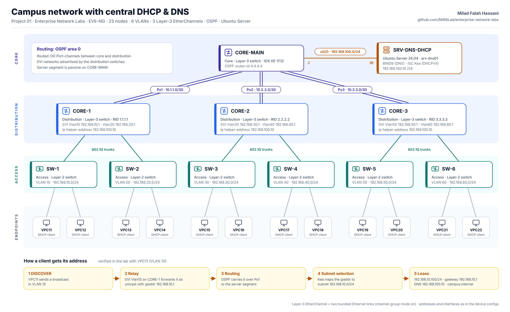
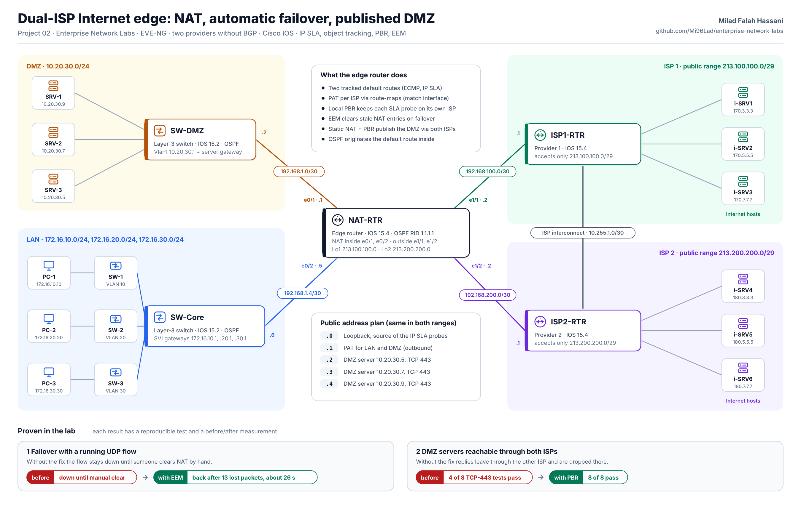

# Enterprise Network Labs

Enterprise network designs, built and tested in EVE-NG. Each project explains the design, reproduces its problems with a test that can be repeated, fixes them and names the limits.

**Milad Falah Hassani** · Network Engineer · CCNP Enterprise 
[LinkedIn](https://www.linkedin.com/in/milad-falah-hassani-4105b0416) · [falahhassanimilad@gmail.com](mailto:falahhassanimilad@gmail.com)

> 🇩🇪 **Kurzfassung:** In diesem Repository dokumentiere ich Enterprise-Netzwerkdesigns, die ich in EVE-NG aufbaue und teste. Jedes Projekt erklärt das Design, weist seine Probleme mit einem wiederholbaren Test nach, löst sie und benennt die Grenzen. Topologie, vollständige Gerätekonfigurationen und Messergebnisse liegen bei.

## Projects

### [01 · Campus network with central DHCP and DNS](01-campus-dhcp-dns/)

A three-tier campus with six VLANs. Core and distribution are connected by routed Layer-3 EtherChannels running OSPF. One Ubuntu server provides DHCP for all VLANs through relay (ISC Kea) and DNS in both directions (BIND9).

- 23 nodes: Cisco IOS XE and IOS switches, Ubuntu Server 24.04, VPCS clients
- Explained step by step: how a server with one interface finds the right subnet for six VLANs (DHCP relay and `giaddr`)
- Migration from local DHCP pools on the switches to one central server
- Verified end to end: a client in VLAN 10 receives address, gateway, DNS server and domain from the central server

### [02 · Dual-ISP Internet edge without BGP](02-dual-isp-nat-failover/)

A LAN and a DMZ behind two providers that each accept only their own address range. Both links are active, NAT follows the exit interface, and IP SLA with object tracking handles failover and failback. Two problems of this design are reproduced, explained and fixed:

- Running UDP flows stayed down after a failover. With an EEM applet they recover by themselves after about 26 seconds.
- DMZ servers published through both ISPs answered only 4 of 8 connection tests. With static NAT per ISP and policy routing for the return path, 8 of 8 pass.
- Documented limit: where this design ends and BGP begins

## Skills shown in these projects

| Area | Technologies | Project |
|---|---|---|
| Campus switching | VLANs, 802.1Q trunks, SVIs, inter-VLAN routing, Layer-3 EtherChannel | 01 |
| Routing | OSPF, tracked static default routes with ECMP, policy-based routing | 01, 02 |
| Network services | DHCP relay, ISC Kea DHCPv4, BIND9 forward and reverse zones | 01 |
| NAT | PAT per ISP with route-maps, static NAT with port translation | 02 |
| High availability | IP SLA, object tracking with boolean lists, EEM applets | 02 |
| Linux | Ubuntu Server 24.04, service configuration and validation | 01 |
| Method | Root-cause analysis, reproducible tests, before and after measurements, documented limits | 01, 02 |

## Lab environment

- EVE-NG Community Edition on VMware Workstation
- Cisco IOL images: IOS XE 17.12 and IOS 15.2 for switches, IOS 15.4 for routers
- Ubuntu Server 24.04 and VPCS endpoints

Cisco images are licensed and are not part of this repository.

## Contact

I am open to network engineering roles in Germany. The fastest way to reach me is [LinkedIn](https://www.linkedin.com/in/milad-falah-hassani-4105b0416).
